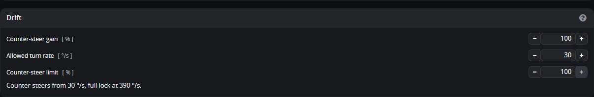

# Profiles

The Profiles tab holds the PID profiles: the steering stabilizer's tune,
how it changes with throttle and speed, the drive aids and the drift
settings. Each profile is a complete set, so a profile can be a tune for one track or surface.

Up to six profiles can be stored (fewer on boards with little memory). Pick
the one to edit from the profile selector at the top; the loaded profile is
shown there. **Copy profile** copies the current one to another, and
**Reset to defaults** resets it. Switch profiles while driving with the
**Profile Selection** function on the [Adjustments](adjustments.md) tab.

Gripora stabilizes the steering only, so the tab shows the steering
values. The controller measures the car's turn rate (yaw rate) with the gyro and steers
so that it follows the rate the steering wheel asks for (set on the
[Rates](rates.md) tab).

## Driving Feel

Driving Feel is where to start tuning. One value per column, with a guide
beside the table saying what each one does:

| Column | What it changes | Raise it if... | Lower it if... |
|---|---|---|---|
| **Master Gain** [%] | How hard the car fights unwanted turning | The car wanders or feels soft, or twitches out of line on bumps or under power | The steering wobbles, buzzes or oscillates at speed |
| **I-Term Decay** [s] | How long it holds its line after a bump | You want it more locked in | It feels too locked in; shorter is freer and suits drifting |
| **I-Term Relax** (1-10) | How firmly it stops at the end of a fast turn or slide | The car kicks back the other way when you centre the wheel | Long, sustained turns lose rate |

The **Throttle** and **Speed** rows change the gain with throttle and speed,
see [Gain attenuation](#gain-attenuation).

Every column is also an [Adjustments](adjustments.md) function, so you can
turn it on a knob while driving. The Setup Wizard can put Master Gain on a
knob for you. A value under live adjustment shows the value being
commanded.

### Master Gain

Master Gain scales the P, I and D terms together, live, without changing
the stored gains. 100% (the default) is the tune as configured. F and B are
not scaled. The range is 0-200%; 0 turns the gyro correction off.

A gain curve can shape it by steering deflection, so the gain tapers in or
out towards full lock; see [Gain Curves](#gain-curves). A **CURVE** badge on
Master Gain shows when one is shaping it.

### I-Term Decay

Master Gain sets how hard the car pushes back against a disturbance; I-Term
Decay sets how long it holds on to that correction before letting it go.
Anything faster than the decay time (a bump, a grip change) is corrected
and the car returns to its line. Anything slower (a slow drift, a trim
offset) is let go, so the controller doesn't keep pulling the car back
towards where it was a few seconds ago.

The default is 0.60 s, the range 0.01-1.00 s. Shorter feels freer and suits
drifting; longer feels more locked in but can start to hold trim errors.
I-Term Decay and I gain overlap: under a steady load, a longer decay holds
more I, much as a higher I gain would. Set I for how firmly a disturbance is
corrected, then I-Term Decay for how long.

The CLI setting is `iterm_decay_time` (in 0.01 s). Its maximum bleed rate,
**I-Term Decay Max Rate** (default 35°/s, `iterm_decay_limit`), is under PID
Controller Settings; leave it at the default.

### I-Term Relax

While you steer quickly, I-Term Relax stops the I-term building up from
your own input, so the car doesn't kick back the other way when you centre
the stick. I-Term Decay deals with what the controller remembers after a
turn; I-Term Relax stops it collecting the turn in the first place.

It is a score from 1 to 10, default 5. Higher means more relax and less
bounce-back; lower keeps more hold through long, sustained turns. Most cars
end up between 5 and 9. If the car kicks back at the end of a turn, raise it
a step at a time.

The CLI setting is `iterm_relax`. It sets the I-term relax filter cutoff,
from 50 Hz at 1 to 3 Hz at 10, with 5 = 10 Hz. The relax **level** (default
22°/s, lower is stronger, `iterm_relax_level`) is under PID Controller
Settings; leave it at the default unless I-Term Relax alone doesn't remove
the kick-back.

## PID Controller Gains

The PID gains table holds the steering loop's P, I, D, F (feedforward) and B
(boost): the stored tune, which Master Gain scales.

- **P** is how tightly the car tracks the steering wheel and corrects a
  bump or grip change right now. Too little and it feels loose and wanders;
  too much and the steering overshoots or oscillates, quickly.
- **I** holds the turn rate over time against steady influences: a camber,
  uneven grip, a car that pulls to one side, a long sweeping corner. Too
  much and the car keeps rotating after a quick steering input is released.
- **D** damps any change in turn rate, from your input or from a bump. It
  reduces overshoot from a high P, but is by far the most sensitive term to
  gyro noise; check [Gyro](gyro.md) filtering before adding it.
- **F** steers from the stick alone, without waiting for an error: a
  sharper response to steering input. Too little feels slow and delayed;
  too much overshoots and kicks back at the end of a steering input.
- **B** adds feedforward from how fast the stick moves, for a sharper start
  and stop, without the drawbacks of a high P or F.

The defaults are P 190, I 45, D 0, F 65 and B 35. F can't be set below 50,
in the Configurator, the CLI, the Lua scripts or an adjustment: F sets most
of the steering for a commanded rate, and P and I only correct what is left.

The **Effective PID Gains** preview shows the gains in use after Master
Gain and the gain attenuation, so you can see the effect on the bench.

### Quick troubleshooting

| What you see | Try |
|---|---|
| Loose, wanders off line, twitches on bumps | Raise Master Gain or P |
| Steering oscillates or wobbles, worse at speed | Lower Master Gain or P; use the Throttle or Speed row to lower it at speed |
| Buzzing servo, hot servo | Lower D, check [Gyro](gyro.md) filtering |
| Steering feels slow or delayed | Raise F |
| Kicks back the other way after a quick input | Raise I-Term Relax; if it overshoots the input itself, lower F |
| Keeps rotating after a quick input is released | Lower I or shorten I-Term Decay |
| Doesn't hold a long corner or pulls to one side | Raise I or lengthen I-Term Decay |

## PID Controller Bandwidth and Settings

Expert settings, best left at their defaults until you need them:

- **Steering Bandwidth** (PID loop bandwidth, Hz), **Steering D-term Cutoff** and
  **Steering B-term Cutoff**.
- **I-Term Decay Max Rate** and **I-Term Relax Level**, above.
- **Error Limit for Steering Axis**: a hard limit on the angle error in the loop,
  so the I-term can never grow past it.

## Gain attenuation

Two rows in Driving Feel scale the steering's P, D, F and B (not I) with
throttle and with speed. Together they never take the gains below 25%.
GYRO OFF is not affected.

### Throttle

The **Throttle** row (`fw_tpa_gain`, 25-200%, default 100%) scales the gains
by a percentage, optionally shaped by a gain curve evaluated on throttle,
0-100%. The curve sees the size of the throttle, so brake and reverse count
the same as forward. 100% with no curve means no change. Use it, for
example, to reduce the gain at high throttle if the steering wobbles under
power.

### Speed (speed attenuation)

The **Speed** row (`fw_spa_gain`, 25-200%, default 100%) scales the gains by
the car's speed, on top of the Throttle row. Steering gets more effective
as speed rises, so a tune that is right at low speed can wobble on a fast
straight. Speed reduces the gain as the car goes faster.

- It does nothing until a **Speed** curve is assigned in
  [Gain Curves](#gain-curves).
- The curve's X axis runs from 0 to the **speed curve range**
  (`fw_spa_speed_max`, 10-300 km/h, default 60), the km/h value beside the
  Speed curve in the Gain Curves panel. Faster than that uses the curve's
  last point.
- The speed is the wheel speed from the motor RPM when the motor has an RPM
  source (see the Drive panel on the [Motors](motors.md) tab), otherwise
  GPS speed. GPS needs a fix.
- If the speed is lost (no RPM source and no GPS fix), the gain holds for 3
  seconds, then eases back to 100%. When Speed engages it eases in rather
  than jumping.

The Configurator's help text on the Speed row still says it needs a GPS;
with an RPM source it doesn't.

A typical start: a curve that stays at 100% up to a moderate speed and falls
to 60-70% at your top speed, with the speed curve range set a little above
it. To see it while driving, log `debug_mode = GAIN_ATTEN` with
[Blackbox](blackbox.md).

### Gain Curves

Gain curves are assigned in the **Gain Curves** panel (advanced): one slot
each for Steering (by steering deflection), Throttle and Speed. The Speed line
also holds the speed curve range in km/h. The shapes themselves are edited
on the [Curves](curves.md) tab. "-" means no curve. Whenever a curve shapes
Master Gain, its cell in Driving Feel shows a **CURVE** badge.

## Drive aids

The **Drive aids** panel holds **ABS**, **traction control** and **launch control**. They shape
the throttle and brake you give before they reach the ESC:

- **ABS** pulses the brake when you brake hard, so the wheels keep turning
  and the car keeps steering instead of locking up and sliding. It works
  only while the ESC is braking a car that is still rolling, and never
  pushes the throttle past neutral into reverse.
- **Traction control** limits how fast the forward throttle may rise, so
  the wheels don't spin up when you pull the trigger hard. Letting off is
  instant, and the brake and reverse are never touched.
- **Launch control** caps the throttle for a standing start, staged with the
  **LAUNCH** mode, and ramps it to full: **Start throttle** and **Ramp time**.

All are **Off** by default. They belong to the profile selected at the
top: each profile has its own, and switching profile switches them. A
**Live** box shows whether the aids are on, what ABS, traction control and
launch control are doing, and the throttle from the transmitter next to the throttle to
the ESC.

The aids are off while disarmed, in failsafe, and while the **DRIVE AIDS
OFF** mode is on ([Modes](auxiliary.md) tab). The ESC's mixer rule must take
Stabilized Throttle, as the car mixer preset does; a rule fed straight from
the RC throttle bypasses them.

What each setting does, and which ESC setups ABS can't run on:
[Drive Aids](../../driving/drive-aids.md).

## Drift

The **Drift** panel sets up the **DRIFT** mode. While DRIFT is on (put it on
a switch on the [Modes](auxiliary.md) tab), the steering wheel steers the
wheels directly, as with GYRO OFF, and the gyro only counter-steers when the
car rotates faster than the allowed rate. There is no heading hold.

| Setting | Default | Range | What it does |
|---|---|---|---|
| **Counter-steer gain** | 100 % | 0-200 % | How hard the gyro counter-steers past the allowed rate. 100 % gives full lock 360 °/s past it; 0 % turns the counter-steer off. |
| **Allowed turn rate** | 30 °/s | 0-720 °/s | Turn rate the gyro leaves alone, so the car can hold a slip angle. Raise it to hold more angle. |
| **Counter-steer limit** | 100 % | 10-100 % | The most lock the gyro adds, as a share of full lock. Lower it if the counter-steer snaps the car straight. |

The line under the settings shows where the counter-steer starts and the
turn rate at which it reaches full lock, or its limit. The settings belong
to the profile selected at the top and are saved and reverted with it. The
panel is hidden on firmware without drift mode.

How DRIFT works with GYRO OFF, failsafe and the drive state, and how to tune
it: [DRIFT](../../driving/drift.md).
