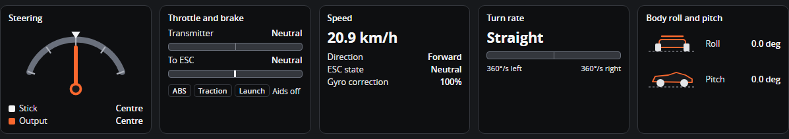

# Status

The Status tab is the first view after connecting. It shows a live summary
of the controller: whether it can arm and, if not, why; the battery; a 3D
car that follows the controller's attitude; and the receiver channels.

Use it as the first check after connecting: a sensor that isn't detected or
a flag that blocks arming shows up here before you go any further.

The **Info** box shows the car name, firmware, board and whether the
configuration has been changed from the defaults, with the run count and
run time. Below the arming and battery boxes, the **Instruments** row shows
what the car is doing, and the 3D car shows heading, pitch and roll;
**Reset Z axis** zeroes the heading shown on it.

## Instruments

- **Steering**: a dial with two needles. **Stick** is your steering wheel;
  **Output** is the steering command the controller sends, worked back from
  the steering servo's pulse, so it includes the gyro correction. With the
  car still and the stick centred they sit together; the gap between them
  is what the gyro adds. If no servo is driven by steering in the mixer,
  the dial says so.
- **Throttle and brake**: two bars around neutral, **Transmitter** (what
  you give) and **To ESC** (what reaches the ESC after the
  [drive aids](../../driving/drive-aids.md)). The **ABS**, **Traction** and
  **Launch** badges are lit while that aid is ready (launch: staged) and
  highlighted while it acts. **Aids off** shows while the drive aids pass
  the throttle through: disarmed, in failsafe or with DRIVE AIDS OFF.
- **Speed**: the wheel speed from motor RPM (or **No RPM source**), the
  travel direction, the ESC state (neutral, forward, brake, reverse) and
  the gyro correction from the [drive state](../../driving/drive-state.md).
- **Turn rate**: the yaw rate from the gyro, left or right, on a scale to
  360 °/s each way.
- **Body roll and pitch**: the car's tilt from the attitude estimate, with
  a small drawing of the car from behind and from the side. The steering
  loop doesn't use it; it is a check that the board orientation is right.

Firmware that doesn't report the drive state shows a note in the speed
card; without the drive aids status only the transmitter throttle is shown.

## Enable Arming

**Enable Arming** lets the car arm while the Configurator is connected,
which it normally can't (the **MSP** flag below). The Configurator asks you
to confirm. Never drive the car with the Configurator connected, and put the
car on a stand with the wheels off the ground before you enable it.

## Arming disable flags

When the car won't arm, the Status tab lists each active arming-disable
flag; hover one for a plain-language explanation. The ones you'll meet most
often on a car:

- **THROTTLE**: the throttle isn't at neutral. A car only arms with the
  trigger at neutral (the channel center, with a small deadband).
- **MSP**: the Configurator is connected. Use **Enable Arming** above for a
  bench test.
- **RX_FAILSAFE**: no valid receiver signal.
- **CALIBRATING**: the gyro is still calibrating; keep the car still after
  power-up.
- **ANGLE**: the attitude estimate isn't ready yet.
- **SETUP**: a setup tool, such as the Setup Wizard or a servo, mixer or
  motor override, is holding the outputs. Arming works again once it lets
  go.
- **BACKUP_RX**: a [backup receiver](../../driving/backup-rx-input.md) is
  configured but hasn't linked yet, so the first arm of the session is
  blocked until every configured backup does. Check the backup receiver's
  power, binding and wiring, or power-cycle it, then confirm its **Link**
  badge on the [Receiver](receiver.md) tab comes up.

The full list of flags, and what clears each one, is in
[Arming and Stick Commands](../../reference/stick-commands.md).
