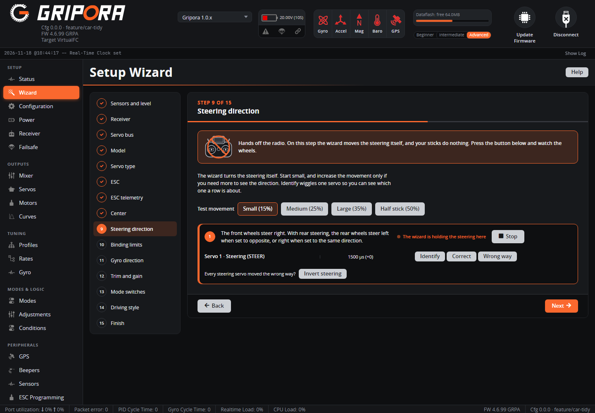

# Set Up Your Car

This page takes a controller that has been [flashed](flashing-the-firmware.md)
and [connected](first-connection.md) through to a car that is ready for its
first run: wiring, then the Configurator's **Setup Wizard**.

!!! warning "Wheels off the ground"
    Several steps move the steering, and the ESC step runs the motor. Put the
    car on a stand with the wheels off the ground for the whole setup. Read
    [Safety](safety.md) first.

## Wiring

A basic car needs three things plugged into the controller:

| What | Where | Notes |
|---|---|---|
| **Receiver** | A serial port (UART), or the board's receiver input | Serial receivers (CRSF/ELRS, FBUS, F.Port, SBUS, SRXL2, Jeti EX Bus and others) go on a UART; the wizard's Receiver step sets the port and protocol. See [Receivers](../reference/receivers.md). |
| **Steering servo** | Servo output **S1** | With rear steering, the rear servo goes on **S2**. Servos on an F.Bus or SBUS line plug into a serial port instead. |
| **ESC** | Motor output **M1** | A reversible car ESC: forward, brake and reverse. A second ESC goes on **M2**. An SRXL2 ESC goes on a serial port, not M1. |

Power the servo as your board's manual describes; many car ESCs supply
servo power through their BEC. If the ESC sends telemetry or has an RPM
wire, connect that too: motor RPM is what lets the controller know the car's
speed and direction (see [Drive State](../driving/drive-state.md)).

Mount the controller firmly, flat and away from the motor where you can.
The wizard finds the board orientation, so any of the usual orientations
works.

## The Setup Wizard

Open the **Wizard** tab once you are connected. It asks one thing at a time,
in the order the settings depend on each other, and checks each answer on
the car as you go.

- **The steps are in order.** Each relies on the ones before it: the Model
  step says which servo steers and which output is the ESC, the steering
  direction comes before the gyro check. You can jump to any step from the
  list on the left.
- **Changes reach the car straight away**, so the steering moves as you
  adjust it. **Save and continue** writes them to the controller's memory and
  moves on. A step you did not change shows **Next**.
- **Some settings only take effect after a restart**: a port, a protocol, the
  servo update rate. A step that changes one shows **Save and Reboot**, and
  the wizard reopens on the same step when the controller is back.
- **The car can't be armed while the wizard is open.** The Status tab shows
  the SETUP flag while a setup tool holds the outputs.
- **Only steering servos.** The servo steps (center, direction, binding
  limits) work on the servos that the mixer drives from the stabilised
  steering. The wizard names them **STEER**, or **F STEER** and **R STEER**
  with rear steering. A servo driven by anything else is left alone.

The same wizard is in the [Ethos Lua Suite](../ethos-suite/tools-and-logs.md)
under **Tools → Setup Wizard**, so setup can also be done from a FrSky radio.
Receiver port and protocol setup is only in the Configurator, because the
radio talks to the controller through the receiver.

| Step | What you do |
| --- | --- |
| 1. Sensors and level | Calibrate the accelerometer, find the board orientation (place the car flat, press the button, then lift the rear by at least 20°) and set level on a level surface. Power on with the car still: the gyro calibrates itself at power-up. |
| 2. Receiver | Choose the port and protocol, then the channel order: **Car** (CH1 steering, CH2 throttle, as on most car radios), or **Detect** for any other order. Check the direction: steering full left and the trigger at full brake should move both bars to the left. Reverse a channel on the radio, not here. |
| 3. Servo bus | Optional. For servos on an F.Bus or SBUS line. See [Servo bus](#servo-bus). |
| 4. Model | **Car** for steering on S1 and the ESC on M1, with optional rear steering on S2 and a second ESC on M2. **Custom** keeps a mix built by hand on the Mixer tab. See [Car Mixer and Channels](../driving/car-mixer.md). |
| 5. Servo type | **Analog** (50 Hz, any servo) or **Digital** (333 Hz, check your servo supports it). One rate for every PWM servo output. |
| 6. ESC | The ESC protocol, how your ESC reverses, a neutral check and a direction check. See [ESC](#esc). |
| 7. ESC telemetry | Optional. If the ESC sends telemetry: its protocol and port, a signal check, battery voltage and current from the ESC, and the motor RPM source and pole count. |
| 8. Center | The steering is held at center. Set the servo horn and linkage so the wheels point close to straight ahead, then fine-tune the center here. |
| 9. Steering direction | The wizard turns the steering right; confirm the front wheels steer right (and the rear wheels the way you chose). **Invert steering** fixes it if every servo is wrong. |
| 10. Binding limits | Find how far each servo can move before the steering or linkage binds. |
| 11. Gyro direction | Overrides are off now and the gyro drives the steering. Turn the car by hand around its vertical axis: the steering should push against the movement. If it doesn't, the step can reverse the gyro for you. |
| 12. Trim and gain | Choose how you trim the steering, and put the stabilizer gain on a knob. See [Radio mixes](#radio-mixes-for-a-gain-knob-and-mode-switches). |
| 13. Mode switches | Put ARM, and any other modes you want, on switches. Only ARM is required. **GYRO OFF** turns the gyro off; **DRIVE AIDS OFF** turns the drive aids off; **LAUNCH** stages a launch for launch control; **DRIFT** turns on [drift mode](../driving/drift.md). |
| 14. Driving style | **Beginner** (steering 90 °/s, 20 % expo), **Sport** (150 °/s, 30 %) or **Drift** (300 °/s, 60 %): how fast the car turns at full steering and how the I-term behaves while you steer. Starting points to tune from. The Drift style sets rates only; it doesn't turn on the DRIFT mode. |
| 15. Finish | A summary of what the wizard set, and the checks before the first run. |

## Servo bus

A controller has a fixed number of servo pins. Servos on an **F.Bus** or
**SBUS** line plug into a serial port instead. Servo 1 is channel 1 on the
bus, servo 2 is channel 2, and so on, and a servo can be on a pin and on the
bus at once. If every servo plugs into a servo pin, press **Next**.

1. **Port.** Choose **None** to use the servo pins only, or a free port. On
   boards with a connector labelled S.BUS, that port is marked as suggested.
2. **Protocol.** F.Bus or SBUS.
3. **Channels.** The highest servo number the bus carries.
4. **Save and Reboot.** The port is opened when the controller starts.
5. **Signal.** With the bus powered, the step shows how many F.Bus servos and
   sensors are answering. If nothing answers, **Detect wiring** tries each
   pin of the port and both signal polarities until a device answers.

SBUS is one-way: nothing answers on it, so check it in the later steps,
where each servo is moved. A bus servo listens to one channel number, set in
the servo itself; for FrSky servos see [FrSky Servos](../setup/frsky-servos.md).

## ESC

**Protocol.** **Standard PWM** works with any car ESC; the ESC learns neutral
and the throttle range in its own calibration. **DShot150** and **DShot300**
are digital and need no calibration (DShot300 for BLHeli_32, BLHeli_S,
Bluejay and AM32; DShot150 can't report motor RPM over bidirectional DShot).
Other protocols, including SRXL2 and Castle Link, are under **Other**. A
change ends with **Save and Reboot**.

**How does your ESC reverse?** Tell the controller what the ESC does below
neutral: **Automatic**, **Brake, then reverse** (most car ESCs), **Reverse
directly** (AM32's default bidirectional mode) or **Forward and brake
only**. The controller follows the same rules to tell when the car is
reversing; see [Drive State](../driving/drive-state.md). Not sure? With the
wheels off the ground, hold forward, let go, then hold reverse straight
away. If the wheels only stop, and turn backwards only after you let go and
hold reverse again, choose **Brake, then reverse**.

**Check neutral.** The controller sends neutral to the ESC as the middle of
the throttle range: 1500 µs with the default range of 1000-2000 µs. With
PWM, calibrate the ESC with its neutral at that value, following the throttle
calibration in the ESC's manual with the throttle trigger centred, or the car
creeps or brakes with the trigger at centre. With the throttle trigger at centre
the wheels must not turn. The car only arms with the throttle at neutral.

**Check the direction.** Tick **The car's wheels are off the ground**, then
hold **Forward** or **Reverse**. The motor runs only while you hold a
button, and stops within a second if the connection drops. Forward must turn
the wheels forward and reverse backward (many ESCs brake first: let go and
hold reverse again). If they turn the wrong way, reverse the motor direction
in the ESC. With a second ESC there is a button for each.

- **SRXL2** (Spektrum Smart ESCs): throttle and telemetry share one signal
  wire, which goes to a **serial port**, not to M1. Choosing SRXL2 asks which
  port. See [Motors](../configurator/tabs/motors.md).
- **Castle Link**: wired like Standard PWM, on M1. Its telemetry comes back
  on the same wire, so no serial port is needed. See
  [Castle ESC Telemetry](../reference/castle-esc-telemetry.md).

## Radio mixes for a gain knob and mode switches

A knob or a switch does nothing until **a mix on the radio puts it on a
channel**. The wizard's **Detect** and **Assign** buttons watch the channels,
so without that mix they find nothing. This is the most common reason a gain
knob or a mode switch "doesn't work".

Both steps show how, with Ethos as the example. On the radio:

1. **Model → Mixes**: add a **Free mix**.
2. Name it (GAIN, ARM and so on). Set **Source** to the knob or switch, and
   **Output** to a spare channel. Leave the weight at 100 %.
3. Do the same for each control, each on its own spare channel. One
   3-position switch can carry two modes.

Then in the wizard, click **Detect** and turn the knob from end to end, or
press **Assign** and flick the switch to its on position. On other radios
(EdgeTX, OpenTX, Jeti and so on) do the same: one mix per control, with the
control as its source and a spare channel as its output.

For the steering trim the step offers **A channel per trim** (the steering
trim on its own spare channel; the radio keeps the trim) or **Trim buttons on
one channel** (the controller keeps the trim and saves it when you disarm),
each with its own radio guide. Only the steering trim matters on a car.

!!! note "Auto trim only"
    The Trim and gain step also offers **Auto trim only**, which relies on
    an AUTO TRIM mode. That mode has been removed from the Gripora firmware,
    so don't choose this option.

## Before the first run

The Finish step lists these checks:

1. With the wheels off the ground, check that forward throttle drives the
   wheels forward and the wheels are tight.
2. With GYRO OFF off, steer and turn the car by hand once more: the wheels
   follow the steering and steer against the movement. With the gyro on,
   steering held off centre on the bench makes the wheels creep to full
   lock, because the car can't turn at the rate the stick asks for. This is
   normal on the bench.
3. Do a range check with your radio.

Also:

- Set up your receiver's own failsafe to put the throttle at neutral, and
  check the controller's failsafe: see [Safety](safety.md) and
  [Failsafe](../configurator/tabs/failsafe.md).
- Take a [backup](backup-and-restore.md) before you start tuning.
- Everything the wizard sets can be changed later on its own tab:
  [Receiver](../configurator/tabs/receiver.md),
  [Mixer](../configurator/tabs/mixer.md),
  [Servos](../configurator/tabs/servos.md),
  [Motors](../configurator/tabs/motors.md),
  [Modes](../configurator/tabs/auxiliary.md) and
  [Adjustments](../configurator/tabs/adjustments.md).
